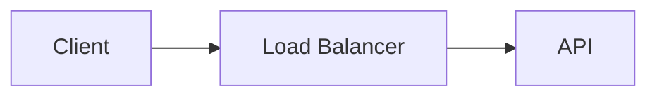

# How to write notes

Files starting with `_` are ignored by the site.

- One folder per roadmap topic: `notes/<topic-slug>/` (topics are defined in `src/data/topics.ts`).
- One `.md` or `.mdx` file per note. The file name becomes the URL: `notes/databases/sharding.mdx` → `/notes/databases/sharding/`.

## Frontmatter

```yaml
---
title: Database Sharding          # required
description: One-line summary     # optional, shown under the title and on the roadmap
status: in-progress               # completed | in-progress | planned  (default: planned)
order: 2                          # position inside the topic (lower first)
tags: [databases, partitioning]
updated: 2026-11-16
draft: false                      # true = only visible in `npm run dev`
---
```

## Diagrams

Use a fenced code block with the `mermaid` language:

````md

````
