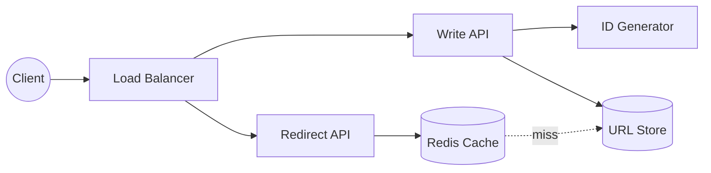

## 1. Requirements

**Functional**

- Given a long URL, return a short unique alias.
- Redirect the short URL to the original.
- Optional custom alias and expiration.

**Non-functional**

- Very high read:write ratio (~100:1).
- Redirects must be low latency (< 50 ms p99).
- Highly available.

## 2. Estimates

- 100 M new URLs / month → ~40 writes/s, ~4,000 reads/s.
- 5 years × 100 M × 500 bytes ≈ **3 TB** storage.

## 3. API

```http
POST /api/v1/urls
Content-Type: application/json

{ "longUrl": "https://example.com/very/long/path", "customAlias": null }

→ 201 Created
{ "shortUrl": "https://sho.rt/aZ3kP9q" }
```

## 4. High-level design



## 5. Short code generation

Base62-encode a unique 64-bit ID:

```ts
const ALPHABET = '0123456789abcdefghijklmnopqrstuvwxyzABCDEFGHIJKLMNOPQRSTUVWXYZ';

export function toBase62(n: bigint): string {
  let out = '';
  do {
    out = ALPHABET[Number(n % 62n)] + out;
    n /= 62n;
  } while (n > 0n);
  return out;
}
```

7 characters of base62 gives 62⁷ ≈ 3.5 trillion codes.

## 6. Open questions

- [ ] Analytics pipeline for click tracking
- [ ] Abuse / malicious URL detection
