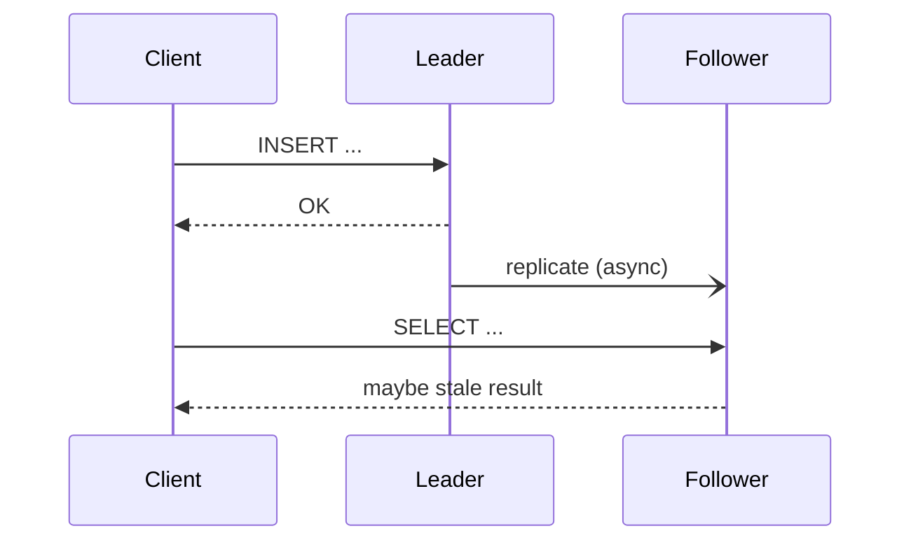

## Leader–follower

All writes go to the leader, which streams changes to followers. Reads can be served by followers (with possible replication lag).

## Sync vs async

- **Synchronous**: durable, but a slow follower blocks writes.
- **Asynchronous**: fast, but data can be lost if the leader fails before replicating.
