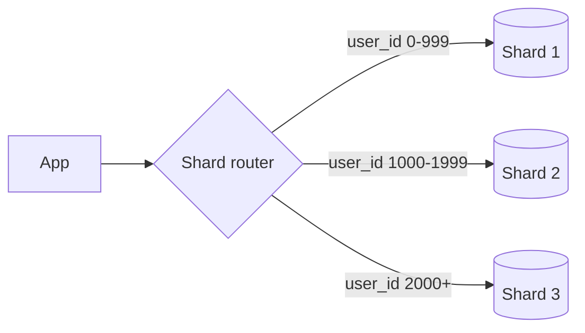

export const Callout = ({ children }) => (
  <div class="not-prose my-6 rounded-lg border-l-4 border-indigo-500 bg-indigo-50 p-4 text-sm dark:bg-indigo-500/10">
    {children}
  </div>
);

This note is written in **MDX**, so it can use components inline.

<Callout>
  Shard only when you have to. Vertical scaling and read replicas are simpler — sharding adds
  cross-shard queries, rebalancing, and operational complexity.
</Callout>

## Sharding strategies

### Range-based

Keys are split into contiguous ranges (e.g. `A–M`, `N–Z`). Easy range scans, but risk of hot spots.

### Hash-based

```sql
-- shard = hash(user_id) % number_of_shards
SELECT * FROM orders WHERE user_id = 42; -- routed to exactly one shard
```

### Directory-based

A lookup service maps each key to its shard. Flexible, but the directory is a dependency.


