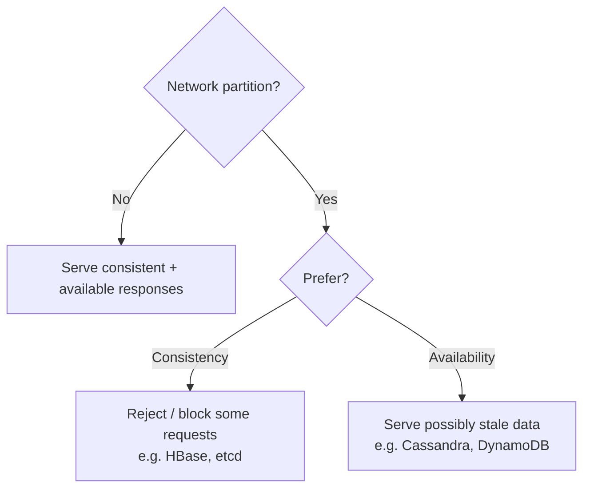

## The three properties

- **Consistency (C)** — every read receives the most recent write or an error.
- **Availability (A)** — every request receives a (non-error) response, without the guarantee that it contains the most recent write.
- **Partition tolerance (P)** — the system keeps operating despite messages being dropped or delayed between nodes.

## Why you must pick two

Network partitions *will* happen, so in practice the choice is between **CP** and **AP** during a partition.

## PACELC: the fuller picture

> If there is a **P**artition, choose **A** or **C**; **E**lse, choose **L**atency or **C**onsistency.

| System    | During partition | Normal operation |
| --------- | ---------------- | ---------------- |
| DynamoDB  | AP               | EL               |
| Cassandra | AP               | EL               |
| MongoDB   | CP               | EC               |
| Spanner   | CP               | EC               |

## Key takeaways

1. CAP is about behaviour **during a partition**, not all the time.
2. "CA" is not a real option for a distributed system.
3. Many databases let you tune consistency per request (e.g. quorum reads).
