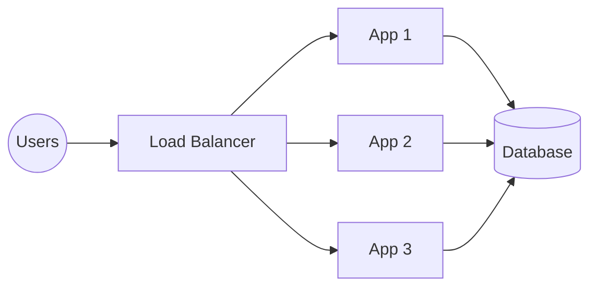

## Why load balance?

A load balancer spreads requests across multiple instances so no single server is overwhelmed, and it removes unhealthy instances from rotation.



## Algorithms

### Round robin

Each request goes to the next server in the list. Simple, but ignores server load.

### Least connections

Route to the server with the fewest active connections — better for long-lived requests.

### Consistent hashing

Maps both keys and servers onto a ring, so adding/removing a server only remaps ~`1/N` of keys.

```ts
function pickServer(key: string, ring: { hash: number; server: string }[]) {
  const h = hash(key);
  const node = ring.find((n) => n.hash >= h) ?? ring[0]; // wrap around
  return node.server;
}
```

## L4 vs L7

| Layer | Sees                  | Example          | Use case                     |
| ----- | --------------------- | ---------------- | ---------------------------- |
| L4    | IP + port             | AWS NLB          | Raw TCP/UDP, very high throughput |
| L7    | HTTP headers, path    | Nginx, AWS ALB   | Path-based routing, TLS termination |

## TODO

- [x] Algorithms
- [ ] Health checks & failover
- [ ] Sticky sessions trade-offs
